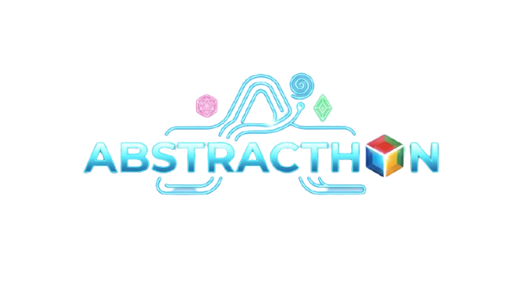

# ⚡ ABSTRACTHON 2026 · Bolivia

<p align="center">
  
</p>

<p align="center">
  <strong>Landing page interactiva de alto rendimiento con estética <em>cyber-abstract</em> para la hackathon nacional organizada por la comunidad Microsoft Learn Student Ambassadors en Bolivia.</strong>
</p>

<p align="center">
  
  
  
  
  
</p>

---

## 🚀 Sobre el Evento

**Abstracthon** es una hackathon presencial diseñada para desafiar la lógica convencional y construir soluciones de alto impacto junto a la comunidad de tecnología.

- 📅 **Fecha:** 21 de noviembre, 7:30 a. m.
- 📍 **Modalidad y sedes:** Presencial en **Santa Cruz** y **Oruro**.
- 🌐 **Organiza:** _Microsoft Learn Student Ambassadors - University Community_.

---

## ✨ Características Principales

- 🌌 **Experiencia 3D con Three.js:** Núcleo icosaédrico deformable en tiempo real con anillos orbitales, satélites y nubes de partículas reactivas al cursor.
- 🧩 **Red de nodos 2D:** Canvas de partículas interactivas con cálculo de proximidad dinámica y colisiones suaves.
- ⚡ **Animaciones fluidas con Motion:** Transiciones físicas, revelados escalonados en scroll (_stagger_), animaciones de entrada y manejo declarativo de modales con `AnimatePresence`.
- 📱 **Arquitectura 100% responsiva:** Adaptación táctil y diseño fluido optimizado para cualquier dispositivo y pantalla móvil.
- 🎨 **Tailwind CSS v4 nativo:** Configuración moderna basada en variables de tema `@theme` y paleta personalizada neón-cyber.
- 🗂 **Arquitectura desacoplada:** Toda la información del evento, cronogramas, sedes y patrocinadores reside en archivos de configuración modulares (`src/config/`).

---

## 🛠️ Stack Tecnológico

| Herramienta                                     | Uso                                                   |
| :---------------------------------------------- | :---------------------------------------------------- |
| **[React](https://react.dev/)**                 | Biblioteca de interfaz de usuario                     |
| **[Vite](https://vitejs.dev/)**                 | Entorno de desarrollo rápido y bundler                |
| **[Tailwind CSS v4](https://tailwindcss.com/)** | Estilos utilitarios modernos y gestión de tema        |
| **[Three.js](https://threejs.org/)**            | Renderizado del viewport 3D interactivo               |
| **[Motion](https://motion.dev/)**               | Orquestación de animaciones e interacciones de scroll |
| **[Lucide React](https://lucide.dev/)**         | Iconografía limpia y estilizada                       |

---

## 📂 Estructura del Proyecto

```text
src/
├── components/
│   ├── common/             # Elementos gráficos transversales (Cursor, Canvas)
│   ├── layout/             # Barra de navegación y pie de página
│   └── sections/           # Módulos del landing (Hero, Sedes, Galería, etc.)
│       └── Hero/           # Composición del Hero y viewport 3D
├── config/                 # Configuración de datos desacoplada (sedes, sponsors)
├── App.jsx                 # Ensamblado principal de la aplicación
├── index.css               # Estilos globales y tema Tailwind v4
└── main.jsx                # Punto de entrada de la aplicación React
```

---

## 💻 Instalación y Desarrollo Local

**1. Clonar el repositorio**

```bash
git clone https://github.com/TU_USUARIO/abstracthon.git
cd abstracthon
```

**2. Instalar dependencias**

```bash
pnpm install
# o bien: npm install / yarn install
```

**3. Iniciar el servidor de desarrollo**

```bash
pnpm run dev
```

**4. Compilar para producción**

```bash
pnpm run build
```

---

## 🤝 Comunidad y Redes

- **Facebook:** Microsoft Learn Student Ambassadors - Bolivia
- **Instagram:** [@microsoft_university](https://www.instagram.com/microsoft_university)
